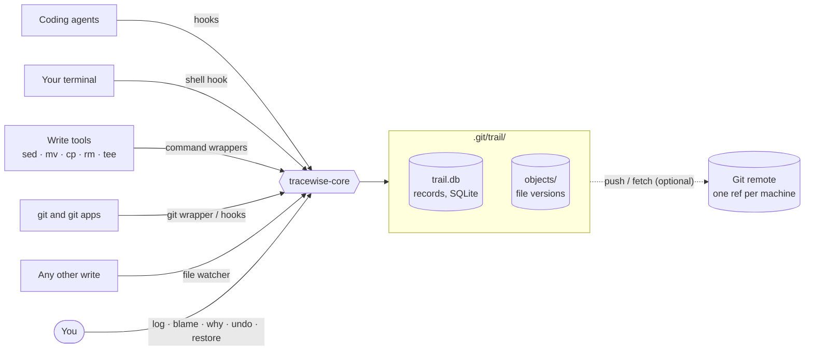

# How it works

Tracewise keeps a second, much finer history next to git: one record for every change to every file, with its author, its reason and the exact lines it touched. This page explains how a change is noticed, who it is attributed to, how it is stored, and how undo works.

## The big picture

One library, `tracewise-core`, owns the data. Several small programs are the ways in: each sees writes from a different place, and together they leave no gap.

## 1. Noticing a change

Changes are noticed by layers. Each layer knows something the others don't; the strongest evidence wins and improves the same record instead of creating a second one.

| Layer | What it sees | How sure it is of the author |
|---|---|---|
| **Agent hooks** | every edit and command of an agent that supports hooks (Claude Code, Codex, Cursor, Gemini, Antigravity) | exact: agent, session and reason |
| **Shell hook** | commands you type in zsh or bash | you |
| **Command wrappers** | `sed`, `mv`, `cp`, `rm`, `tee` run from any shell or script | from the process tree |
| **Git wrapper and git hooks** | checkouts, merges, pulls, resets — also from GitHub Desktop and editors | git |
| **File watcher** | every write on disk, from anything | unknown, or *you (likely)* when nothing else is active |
| **Strict sensor** *(optional)* | the exact process behind every write, from macOS's own security events | exact |

Each layer opens a short **window**: "this actor may be changing these paths from now until then". When a file changes, Tracewise matches it against the open windows — agent first, then git, then your shell — and records the author with a confidence level: `exact`, `likely` or `unknown`. Commands run inside an agent's own shell belong to that agent, so Claude's `sed` and yours are told apart.

## 2. Recording a change

1. A layer names a path that may have changed.
2. Tracewise hashes the file (BLAKE3). If the hash is the one it already knows, nothing happened.
3. Otherwise it stores the new content once, computes the changed lines against the previous version, and updates the file's line map, so unchanged lines keep pointing at the change that wrote them.
4. It attributes the change (above), and links the command that caused it and the reason that covers it.
5. It writes the record.

A delete and a create with the same content become one **rename**. Large files (over 5 MB) and binary files are recorded by hash only. Symlinks and the executable bit are recorded too.

## 3. Reasons

A reason answers *why* a change was made, and is what `why` and `blame` show next to each line.

- **Agents** declare a reason before they edit: through their hooks, `tracewise intent add`, or `tracewise run --why`. Depending on the [reasons mode](configuration.md#reasons), Tracewise lets the edit through, warns, or denies it until a reason is given — and tells the agent exactly how to give one.
- **People** are never forced. Add a reason later with `tracewise note`, or just commit: the commit message becomes the reason of your changes that have none.
- At the start of each turn, an agent is told what *others* changed in the files it is working on, with their reasons — so it doesn't overwrite your fix without knowing.

## 4. Storage

Everything lives in `.git/trail/` of the repository:

| | |
|---|---|
| `trail.db` | the records, in SQLite (WAL mode) |
| `objects/` | the file versions, as git blobs. Versions already in your git history cost nothing extra; `tracewise gc` packs the rest with deltas |

Git never shows or commits this folder, and all worktrees of a repository share it. Files are readable by you only. Measured sizes: 1,000 small edits take about 3 MB; 5,000 edits of 10–100 lines about 42 MB, with `log`, `blame` and `verify` each under 30 ms.

By default each change is flushed to disk before it is reported as recorded, so even a power cut loses nothing.

## 5. Integrity

Every record carries the hash of the record before it — a hash chain. `tracewise verify` walks the chain and checks that every stored version is still there; any altered, removed or reordered record is detected. A small `chain-head` file next to the database also catches deletion of the newest records.

## 6. Undo, redo and restore

Undo works on **lines**. Taking back a change means removing exactly the lines it wrote, with a three-way merge against what the file looks like now:

- your later edits to other lines of the same file stay;
- if someone has since changed the very same lines, the conflict is listed and nothing is forced (`--strict` refuses any file edited since);
- `undo --actor`, `--session`, `--intent` and `--command` take back a whole set of changes at once — everything an agent did in an hour, one task, or one bulk command like a formatter run.

Every undo is recorded as a change of its own, and `redo` puts back exactly what an undo removed. `restore` replaces a whole file with its content at any change or time. History is never rewritten.

## 7. Locks

With the `coordination` [profile](configuration.md#profiles), Tracewise keeps two writers off one file:

- an agent that is about to edit a file takes a lock on it; another agent that tries the same file is **denied** before it writes, and told who holds it;
- after *you* save a file, agents wait a short grace period (20 s) before editing it;
- a person or script can't be stopped, but a write to a locked file is recorded as a conflict, and the holder is told at its next turn.

Locks are advisory and local to one machine. Locks expire after two minutes without activity; `tracewise lock list` and `tracewise lock release` manage them.

## 8. Speed and safety

The paths that run on every command — hooks, the shell hook, the wrappers — do at most a couple of indexed database queries: a hook answers in about 7 ms and a read-only git command through the wrapper adds under 3 ms. Heavy work (scanning, diffs, packing, sharing) runs in the background watcher.

Tracewise **fails open**: if anything in it goes wrong, git, your shell and your agents keep working. The only things it ever refuses are the ones you switch on: an agent edit without a reason (in `enforce` mode), an edit of a file another agent holds, and an agent trying to change Tracewise's own settings or history.

## 9. Privacy

Nothing leaves your machine unless you turn on [sharing](sharing.md). Before anything is stored, known secret shapes (AWS keys, GitHub tokens, bearer tokens, passwords in URLs) are masked in command text and reasons, and a file that contains a known credential is recorded by hash only, so the key is in no stored version. Ignored files (`.gitignore`, `.trailignore`) are never recorded.
